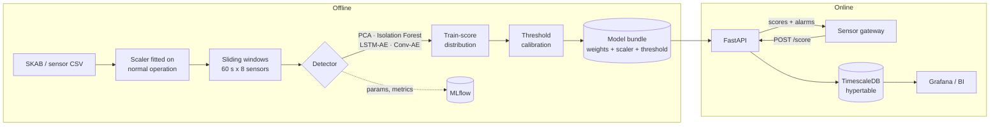

# IoT Anomaly Detection

[](https://github.com/Isaac19911369/iot-anomaly-detection/actions/workflows/ci.yml)


Unsupervised deep-learning anomaly detection for **multivariate industrial sensor streams**, packaged the way it would run in production. It includes a reproducible benchmark, a model bundle with a calibrated alarm threshold, a FastAPI scoring service, score persistence in TimescaleDB, and MLflow experiment tracking.

The benchmark uses the public [Skoltech Anomaly Benchmark (SKAB)](https://github.com/waico/SKAB). SKAB has 8 sensors (vibration, current, pressure, temperature, voltage, flow) on a water-circulation testbed, with labelled faults such as valve closures and cavitation.

---

## Why this project

Industrial anomaly detection rarely fails on model architecture. It usually fails on the parts around the model:

- **Labels are scarce.** Models must learn "normal" from a short period of clean operation.
- **Signals drift.** Temperature and load change slowly, so a naive model treats normal drift as a fault.
- **Alarms have a cost.** Every false alarm erodes operator trust, so the threshold and the false-alarm rate matter as much as F1.
- **It has to run.** Scoring must be streaming-friendly, low-latency and auditable.

This repository addresses each of these points explicitly.

## Architecture



| Component | Path | Notes |
|---|---|---|
| Data loading | `src/iot_anomaly/data/` | SKAB download and loader, synthetic generator, windowing, scaler |
| Detectors | `src/iot_anomaly/models/` | Shared `Detector` interface; PyTorch and scikit-learn implementations |
| Pipeline | `src/iot_anomaly/pipeline.py` | Scale → window → score → threshold; save and load as one bundle |
| Benchmark | `src/iot_anomaly/benchmark.py` | SKAB per-file protocol, aggregated metrics, Markdown and JSON report |
| Serving | `src/iot_anomaly/serving/` | FastAPI app, input validation, optional TimescaleDB writer |
| Tracking | `src/iot_anomaly/tracking.py` | Optional MLflow logging (no-op when disabled) |

## Results on SKAB

The benchmark follows the **SKAB per-file protocol**: 34 recordings from `valve1`, `valve2` and `other`. For each file:

- The first 400 rows (normal operation) are used to fit the scaler, the detector and the threshold.
- The remaining 23,801 rows are scored.
- Metrics are computed over all test points of all files together.

The threshold is `median + 1.5 × (q99 − median)` of the scores on the training data, the usual "1.5 × 99th percentile" upper control limit.

| Model | F1 | Precision | Recall | FAR % | MAR % | ROC-AUC | Runtime (s, CPU) |
|---|---|---|---|---|---|---|---|
| **Conv-AE** | **0.728** | 0.768 | **0.692** | 24.13 | **30.82** | **0.796** | 45 |
| LSTM-AE | 0.715 | 0.774 | 0.664 | 22.41 | 33.64 | 0.784 | 71 |
| PCA (Q-statistic) | 0.609 | 0.687 | 0.546 | 28.86 | 45.37 | 0.592 | <1 |
| Isolation Forest | 0.132 | 0.891 | 0.071 | **1.01** | 92.88 | 0.739 | 6 |
| *always alarm (reference)* | 0.698 | 0.537 | 1.000 | 100.00 | 0.00 | 0.500 | – |

*FAR = false alarm rate. MAR = missed alarm rate. Both are in % and are SKAB's standard metrics. The numbers come from `iot-anomaly benchmark` with `configs/default.yaml` (seed 42) on a 2-core CPU.*

**How to read this table:**

- **F1 alone is misleading on SKAB.** 54% of test points are anomalous, so raising an alarm on every point already scores F1 = 0.70. That is why the report always adds an *always alarm* reference row, and why FAR, MAR and the threshold-free ROC-AUC are shown next to F1.
- **The autoencoders give the best balance.** Conv-AE is the only model that beats the trivial baseline on F1 while keeping FAR well below 100%. It also has the highest ROC-AUC.
- **Isolation Forest shows the opposite trade-off.** It is almost silent (FAR 1%) but misses 93% of anomalous points. Its ROC-AUC of 0.74 shows the ranking is useful, so in practice it would need a much lower, cost-based threshold.
- **Drift is the main source of false alarms.** Temperature and thermocouple readings drift slowly after the 400-row training window, which pushes normal points out of distribution. See [Limitations](#limitations-and-next-steps).

### Design decisions

| Decision | Rationale |
|---|---|
| Train only on the anomaly-free head of each recording | Mirrors deployment: you get a short period of known-good operation, not labels |
| Score the **newest reading** of each window (`score_on: last`) using mean absolute error | Alarms are causal and localised in time, which suits streaming. MAE is less dominated by a single drifting sensor than MSE. Compared with the full-window MSE score on the benchmark, it cut FAR from about 97% to 24% at similar F1 |
| Point-wise PCA and Isolation Forest | Flattened 60 × 8 windows give 480 dimensions for about 340 training samples, which overfits badly. Point-wise use is also how these methods work in process monitoring |
| Threshold calibrated on training scores, stored in the bundle | The threshold is part of the model version, so it is auditable and reproducible |
| One `Detector` interface for every model | Benchmark, serving and tests treat all models the same, so adding a model takes one class |

## Quickstart

```bash
git clone https://github.com/Isaac19911369/iot-anomaly-detection.git
cd iot-anomaly-detection
python -m venv .venv && source .venv/bin/activate
pip install torch --index-url https://download.pytorch.org/whl/cpu   # or a CUDA build
pip install -e ".[dev,serve,tracking]"

iot-anomaly download                 # fetch SKAB (about 35 CSV files, not redistributed here)
iot-anomaly -v benchmark             # reproduce the table above (about 2 min on CPU)
iot-anomaly benchmark --models conv_ae lstm_ae
```

### Train and serve a model

```bash
# learn "normal" from the first 400 rows of a recording
iot-anomaly train --model conv_ae --csv data/skab/valve1/1.csv --rows 400 --out artifacts/model
iot-anomaly serve --model-dir artifacts/model          # http://localhost:8000/docs

# replay the recording against the API as a live stream
python scripts/replay.py data/skab/valve1/1.csv --url http://localhost:8000 --block 60
```

Example request:

```bash
curl -X POST localhost:8000/score -H 'Content-Type: application/json' -d @- <<'JSON'
{
  "device_id": "pump-01",
  "timestamps": ["2020-03-09T10:14:33", "..."],
  "readings": [[0.0266, 0.0401, 1.33, 0.0547, 79.34, 26.02, 233.06, 32.0], "..."]
}
JSON
```

The response contains one score and flag for every reading that completes a 60-reading window, the model's threshold, and the server-side latency. With `timestamps` provided and `DATABASE_URL` set, scores are also written to a TimescaleDB hypertable `anomaly_scores`.

| Endpoint | Purpose |
|---|---|
| `GET /health` | Liveness probe |
| `GET /model` | Model name, window size, threshold and expected feature order |
| `POST /score` | Score a block of consecutive readings |

### Full stack with Docker Compose

```bash
docker compose run --rm trainer   # downloads SKAB, trains Conv-AE, logs the run to MLflow
docker compose up -d api          # API on :8000, TimescaleDB on :5432, MLflow UI on :5000
```

## Configuration

All settings are in [`configs/default.yaml`](configs/default.yaml) and map to typed dataclasses in `config.py`. Unknown keys are rejected, so a typo fails loudly instead of being ignored.

```yaml
data:      { window: 60, train_rows: 400, subsets: [valve1, valve2, other] }
model:     { name: conv_ae, hidden_dim: 32, latent_dim: 8, score_on: last }
training:  { epochs: 40, batch_size: 32, lr: 0.001, seed: 42, device: auto }
threshold: { quantile: 0.99, scale: 1.5 }
tracking:  { enabled: false, tracking_uri: mlruns }
```

## Engineering

- **Tests:** `pytest` runs 20 tests in about 5 s. They cover windowing and scaling, metrics against hand-computed values, each detector separating injected anomalies on synthetic data, save/load round-trips that reproduce the same scores, config validation, and API behaviour and input validation.
- **CI:** GitHub Actions runs ruff lint and format checks and the test suite on Python 3.10 and 3.12, then builds the Docker image.
- **Reproducibility:** seeds are fixed, data download is deterministic, and the benchmark writes `artifacts/benchmark/results.{md,json}`.
- **Container:** CPU-only PyTorch image, non-root user, health check.

## Limitations and next steps

- **No separate validation split.** The scoring choice (newest reading, MAE) was made by comparing alternatives on the same benchmark files, so the numbers are slightly optimistic. A held-out set of SKAB files would fix this.
- **Drift handling.** The model is fitted once on a short window. Rolling re-baselining, or modelling slow features with a separate trend model, would directly attack the main source of false alarms.
- **Alarm logic.** Debouncing (requiring *k* consecutive exceedances) and hysteresis lower FAR considerably at some cost in MAR. They should be tuned to the real cost of a missed fault versus a false alarm.
- **Event-level metrics.** Add SKAB's NAB scoring and changepoint detection to evaluate *when* a fault is detected, not only how many points are flagged.
- **Model and serving roadmap:** a Transformer autoencoder and USAD/TranAD-style models, ONNX export, NVIDIA Triton serving, and Kubernetes manifests with Helm.

## Data and licence

The SKAB data is downloaded at runtime from the [official repository](https://github.com/waico/SKAB) and is subject to its licence. It is not included here. If you use SKAB, please cite: *Katser, I. D., & Kozitsin, V. O. (2020). Skoltech Anomaly Benchmark (SKAB). Kaggle.*

The code in this repository is released under the [MIT License](LICENSE).

---

Built by [Dr. Eshagh Dehmollaian](https://github.com/Isaac19911369). My PhD research covered deep-learning anomaly detection in wireless systems, and I now work on applied AI for industrial IoT.
